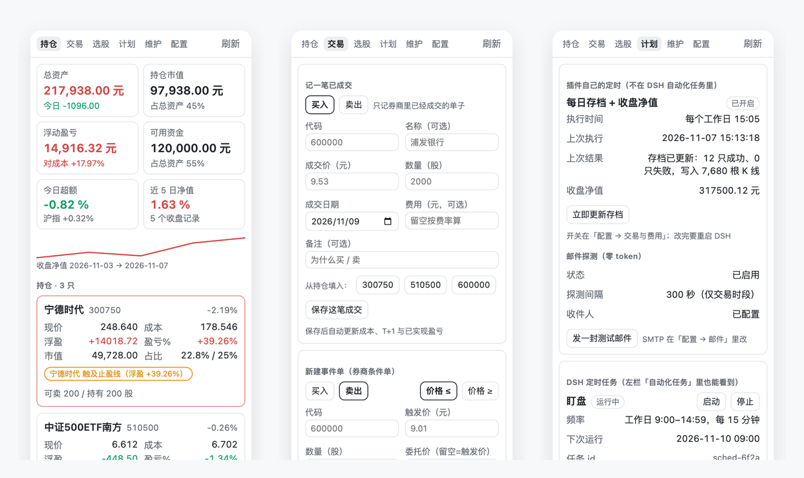
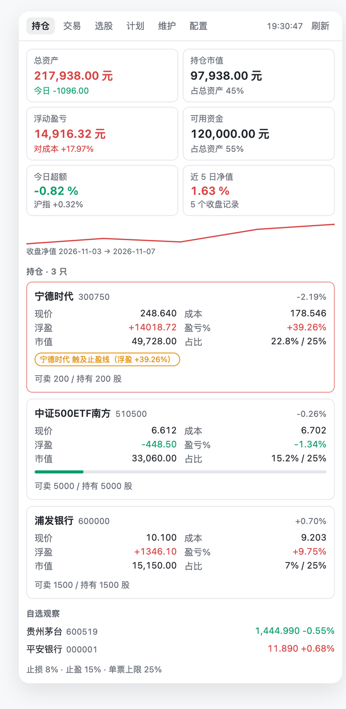
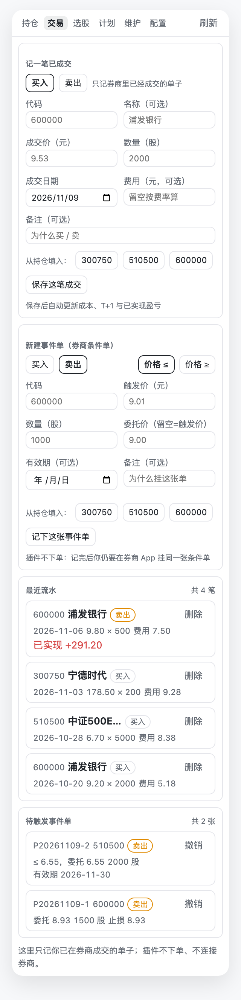
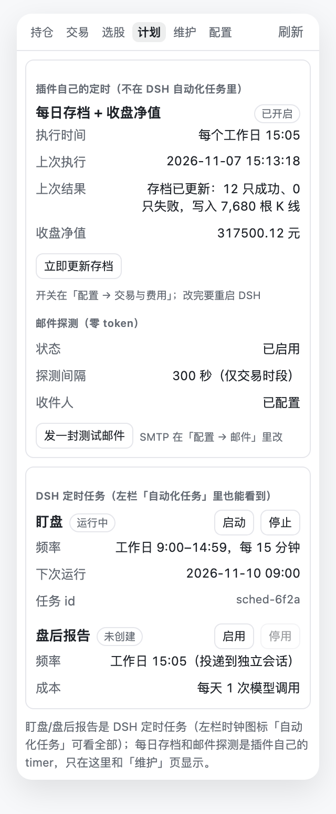

# dsh-astock

Make DeepSeek Harness actually understand your portfolio: watch the market, keep the ledger, size the orders, check the sentiment, run backtests — **you place the trade in your broker app, the plugin does the math**.



*Positions · Trade · Plan — rendered from the real plugin panel, sample data.*

> No order channel: no placing, no cancelling, no broker login. It fetches, records and calculates.

## Three things it does for you

- **Gets the numbers right**: live price, cost basis, unrealised P&L, T+1 sellable shares, stop/take-profit levels and the exact fee of this sell — all from *your* ledger, not an estimate.
- **Keeps the books**: every fill, every conditional order and every backup lands in a local SQLite file. Move machines by copying one directory; nothing goes to a server.
- **Watches when you can't**: on trading days it checks positions and watchlist on a schedule, alerts only when a threshold fires, and can send a zero-token risk e-mail.

Ask an AI about a stock today and you usually get a plausible-sounding paragraph backed by no data. **dsh-astock** is a [DeepSeek Harness](https://github.com/deepseek-ai/deepseek-harness) (DSH) plugin that fixes that: it fetches live quotes, reads your real position ledger, and answers with numbers.

It has **no order channel** — no placing, no cancelling, no broker login. You always execute in your own broker app; the plugin only fetches, records and calculates.

> **⚠️ Read this first**: this plugin is a **tool, not an adviser**. It does not recommend trades, does not manage money, and promises no returns. Quotes come from public APIs and may be delayed, missing or wrong; the maths depends entirely on the trades and fee rates *you* enter; the model can misread the data. **You trade at your own risk — the authors and contributors accept no liability.** Full terms: [Disclaimer](#disclaimer).

## Install in 30 seconds

```sh
# From DSH: Settings → Plugins, or on the command line:
dsh plugin --profile desktop add github:LaynePeng/dsh-astock
```

Fully quit and reopen DSH, then pick **A股助手** from the `+` at the end of the right sidebar tab strip. The npm package is not published yet — see [docs/PUBLISHING.md](docs/PUBLISHING.md).

> macOS and Windows. QQ / 163 mailboxes use an app password; Outlook / Hotmail use OAuth2 with a built-in public client (no Azure registration needed).

---

## What it looks like

### Positions: know whether to act, at a glance



- Equity / market value / unrealised P&L / cash, plus today's excess return vs. the Shanghai index and a 5-day closing-equity curve.
- Each holding shows price, cost, P&L, weight vs. the single-name cap, how much of the stop is used, and how many shares are sellable today.
- A stop, take-profit or overweight condition turns the card red with the reason.

### Trade: record a fill, or park a conditional order



- **Record a fill**: side, code, price, shares, date, fee override, note — the ledger updates cost, T+1 and realised P&L.
- **Create a conditional order**: code, side, trigger (price ≤ / ≥), trigger price, shares, limit price, expiry — the same fields your broker app asks for.
- Deleting a fill asks twice and rebuilds positions; conditional orders can be cancelled and are matched on fill by `astock_sync`.

### Plan: two kinds of schedules, side by side



- **Plugin timers**: daily 15:05 archive + closing equity, mail probe — these are not DSH automation tasks, and their last run is shown here.
- **DSH scheduled tasks**: watch (weekdays 9:00–14:59) and the post-close report (15:05), with start/stop buttons.
- The clock icon in the left sidebar ("Automation tasks") lists every DSH task; this page shows the ones that belong to the plugin.

---

## Ask in chat

Copy any of these:

> "How is my portfolio doing — anything I should handle?"
>
> "600000 is below 9.5. Should I stop out? Include the fees."
>
> "How is the market today — did I beat the index?"
>
> "Scan with all three strategies and tell me which one fits now."

---

## Before vs after

| Task | Plain chat | With dsh-astock |
|---|---|---|
| "How is my portfolio?" | "Please provide your cost basis and share counts" | Reads the ledger: P&L, T+1 sellable, weight |
| "Where should I stop out?" | A generic percentage | Break-even price, stop and target computed from your cost and fees |
| "What are the fees on this sell?" | A rough guess, stamp tax usually missing | Commission / stamp tax / transfer fee itemised |
| "Check the price" | Stale training data | Live snapshot: price, limit-up/down, volume ratio, turnover |
| "Any news I should care about?" | Generic commentary | 7 evidence classes with divergence flags |
| "Watch it for me" | No real scheduling | Every 15 min during market hours |
| "Is this a long-term hold?" | Vague opinion | Segment revenue share, technical position, 3-strategy scores |

---

## The 19 tools

Same names, same parameter schemas, same output wording as the upstream A-share plugin (schemas are exported from upstream, not hand-copied); see [Provenance & credits](#provenance--credits).

| Group | Tools |
|---|---|
| Market | `astock_quote` `astock_kline` `astock_search` `astock_screen` `astock_flow` `astock_extra` |
| Ledger & maths | `astock_calc` `astock_record` `astock_portfolio` `astock_hint` `astock_sync` `astock_act` |
| Research | `astock_sentiment` `astock_business` `astock_events` |
| Quant | `astock_pick` `astock_backtest` `astock_archive` |
| Watch | `astock_watch` |

All tools **only read public market data and only write a local SQLite ledger**.

---

## Install details (package name / Windows / troubleshooting)

### Know which package this is (important)

This project is **`@laynepeng/dsh-astock`**. It is **not published on npm**. Install it with `dsh plugin --profile desktop add github:LaynePeng/dsh-astock`; use `link:` only when developing against a local checkout.

> **Do not** search the plugin market for `dsh-astock`: the npm package [`dsh-astock`](https://www.npmjs.com/package/dsh-astock) is a **different author's** A-share/HK quant workbench. Installing it and then pasting this repository's `cordis.patch.yml` into your profile leaves an insert row for a module that is not installed. On a cold boot that can fail the host; the Desktop recovery dialog then renames your `cordis.patch.yml` to `cordis.patch.yml.bak-<epoch>` and writes an `[]` stub — which looks as if your entire config was deleted. Recovery is below.

### Requirements

- DSH already running (Desktop or `dsh web`)
- **Node.js 22.13+** (no third-party dependencies, no `npm install`; `node:sqlite` no longer needs a flag on 22.13+). DSH bundles Node, so usually nothing extra is needed
- **pnpm** (DSH's plugin manager uses it). If missing, run `corepack enable` or `npm i -g pnpm`, then open a new terminal and check `pnpm -v`

### Install

From GitHub (or `link:` for a local checkout):

```sh
dsh plugin --profile desktop add github:LaynePeng/dsh-astock
# local development:
# dsh plugin --profile desktop add link:/absolute/path/to/dsh-astock
# Windows: dsh plugin --profile desktop add link:C:/codes/dsh-astock
```

Desktop uses the `desktop` profile; `--profile web` installs into a different profile and nothing shows up in the UI. Use `link:` rather than `file:`: the former symlinks, so source edits apply immediately; the latter copies.

Confirm the package is this project (it must print `@laynepeng/dsh-astock 0.9.3`):

```sh
node -e "const p=require(process.argv[1]); console.log(p.name, p.version)" \
  ~/.dsh/profiles/desktop/node_modules/@laynepeng/dsh-astock/package.json
```

On Windows (cmd) use `%USERPROFILE%\.dsh`; PowerShell uses `$env:USERPROFILE\.dsh`. If that directory is absent, you installed something else (for example the npm `dsh-astock`); remove it and use the `link:` command above.

**Restart DSH afterwards.** DSH locks the plugin module set at startup; nothing changes until you restart, then hard-refresh the page and open a new session.

Verify:

```text
http://127.0.0.1:<your-dsh-port>/api/dsh-astock/info
```

Expect `"version": "0.9.3"`, `"tools": 19`, `"configSchema": true`, `"settingsFields": 45`.

### It broke: config looks wiped / DSH will not start

The plugin did **not** delete your config. When the host fails to boot, the Desktop recovery dialog offers "disable third-party plugins"; choosing it runs DSH's `sanitizeProfile`, which **renames** `profiles/<name>/cordis.patch.yml` to `cordis.patch.yml.bak-<epoch ms>`, writes an `[]` stub and restores the official bundle list. The original file is still there — only its name changed.

**Do not** delete `~/.dsh`, the profile directory, or `node_modules`. Instead:

1. **Quit DSH completely** (close the Desktop window; `Ctrl+C` for the CLI), so no live instance writes back.
2. From this checkout, run the read-only diagnosis (defaults to `~/.dsh` and the `desktop` profile):

   ```sh
   node scripts/recover.mjs --profile desktop
   ```

   It lists `.bak-*` backups, the live patch, and any **bundle / insert rows that cannot resolve** (the most common boot failure). Use `--home <path>` if `DSH_HOME` is custom, and `--profile <name>` for another profile.
3. Restore the newest backup **that has content** (the live file is renamed to `.bak-<now>` first; the script never deletes anything, and empty stubs are skipped):

   ```sh
   node scripts/recover.mjs --profile desktop --restore newest
   ```
4. Verify composition, then start:

   ```sh
   dsh --profile desktop --dump-default-config   # bundle layers only
   dsh --profile desktop --dump-config            # plus profile and home user layers
   dsh --profile desktop
   ```

   The first passing and the second failing means the bad row is in a **user layer** (`profiles/desktop/cordis.patch.yml` or `~/.dsh/cordis.patch.yml`). Both failing means the bundle or package itself.
5. If the diagnosis reports an insert row for an uninstalled package (for example `name: '@laynepeng/dsh-astock'`):
   - reinstall the package (`dsh plugin --profile desktop add link:/absolute/path/to/dsh-astock`), **or**
   - delete only that row from the profile's `cordis.patch.yml`;
   - **never** paste this repository's whole `cordis.patch.yml` into the profile patch — it is a bundle patch and DSH applies it automatically once the package is installed.

> **Windows**: replace `~/.dsh` with `%USERPROFILE%\.dsh` (PowerShell: `$env:USERPROFILE\.dsh`), or `%DSH_HOME%` when set. Backup names are the same `cordis.patch.yml.bak-<epoch ms>`.
>
> Desktop crash reports live in `~/Library/Logs/DeepSeek Harness/` (Windows: `%APPDATA%\DeepSeek Harness\logs`). Keep the report before choosing recovery; the first `Error` in it is the root cause.

**Known failure: boot reports `duplicate factory registration for "dsh-astock"`**

Up to 0.8.2, `lib/client.js` registered the browser module under `dsh-astock` while the package is `@laynepeng/dsh-astock`. DSH's client-modules key modules by **package name**: the row is not found after the first execution, the loader falls back to the package URL and runs the same bundle again, and the second registration throws this error, so web boot reports `@laynepeng/dsh-astock: import failed`. Fixed in 0.8.3 (the id is now `@laynepeng/dsh-astock`; 0.9.3 includes it). If it still happens after upgrading, the host is running the old files: remove `node_modules/@laynepeng/dsh-astock` and reinstall, or restart DSH.

Uninstall: `dsh plugin --profile desktop remove @laynepeng/dsh-astock`.

---

## Configuration

**Sidebar → A股 → 配置 is the only entry point.** The top half is a four-step mail wizard (provider → account → from/to → advanced & test); the bottom half is six "other settings" groups, all expanded by default. Saving applies immediately.

DSH 0.2.x's Plugins page does not reliably render a config form for third-party bundles, so the plugin ships this hand-drawn page: all 45 fields live there and nothing depends on the host.

Wizard steps:

1. **Sender provider** — Outlook/Hotmail, QQ, 163, Gmail, custom SMTP. Picking one fills in host, port, TLS and auth mode.
2. **Account** — OAuth2 device code (Outlook: "authorise → enter code in browser → done") or an **app password / authorisation code** (QQ / 163 / Gmail; not your login password).
3. **From / to** — sender address, display name, recipients (blank = send to yourself).
4. **Advanced & test** — SMTP host / port / implicit TLS, client id / tenant, alert level, probe interval, post-close report, and **"save and send a test mail"**.

The six groups below the wizard cover fees (commission, minimum, stamp tax, transfer fee, daily 15:05 archive, archive-on-backtest), risk thresholds (stop / take-profit / trailing / position cap / add & reduce ladders), alerts (volume ratio, intraday drop and rise, trade-sync price tolerance), fetch limits and cache TTLs, picking defaults (strategy, position count, cash usage, reserve, candidates, amount floor, auto hit-rate), and the watch interval.

> **Ledger and archive paths are deliberately not on the panel**: changing them swaps your whole account and can point a real ledger at an empty database. Use the import in **维护 → backup & migrate**, or edit `~/.dsh/astock-data/settings.json` directly (mode 0600; the OAuth refresh token lives in `oauth.json`). Host config (`cordis.patch.yml`) still applies; local settings win.

The ledger defaults to `~/.dsh/astock-data/ledger.sqlite`. On first start, an existing legacy `~/.lite-work/astock-data` is copied over once (ledger, archive, equity, backtest, backups), and the legacy directory is no longer read or written.

---

## Risk e-mail alerts

Sent when a holding hits stop-loss, take-profit, a large intraday move or exceeds the position cap.

**Zero model tokens**: the plugin runs the check itself every 5 minutes (a plain subprocess), only on weekdays 09:10–15:00. Same signal for the same ticker fires at most once per 6 hours, capped at 12 mails per hour.

Configure it in **A股 → 配置**: the four-step wizard ends with "save and send a test mail", and the result banner tells you exactly which step failed. Use an **app password / authorisation code**, not your login password — most providers reject that. Microsoft has been retiring **Basic auth for SMTP** on Outlook.com personal accounts as well as Microsoft 365, so an app password may still be rejected (`535 5.7.139`); in that case switch to OAuth2 for Outlook, or use a different sender mailbox (QQ/163/Gmail app password) and keep the Outlook address as the recipient.

---

## Market watch

Say "start watching" and the plugin creates a DSH scheduled task: weekdays 09:00–14:59, every 15 minutes, delivered to a **separate session** so it never interrupts an ongoing conversation. It reports only when a threshold fires; otherwise it replies with one line.

**Note the cost**: the upstream watcher is a probe that only wakes the model when a fingerprint changes. DSH has no probe, only scheduled tasks, so each run invokes the model. That is why the default interval is 15 minutes and why it only runs during market hours.

---

## Maintenance panel (A股 → 维护)

DSH's settings page is generated from a schema and cannot host buttons, so every "do it now" action lives in the **维护 (maintenance)** tab:

- **Local archive** — coverage and size, plus **update now**. Every weekday at **15:05** the plugin also updates it in a plain subprocess (**zero model tokens**) and records a closing equity snapshot; the mini curve on the positions tab is built from those snapshots. If the app opens at 15:20 it catches up; weekends and pre-15:05 are skipped.
- **Strategy backtest** — last cached recommendation rate / sample / excess / drawdown, plus **run now** (6–14 s, no model tokens).
- **Automation** — enable/disable the **post-close sentiment report** (weekdays 15:05, delivered to a separate session; one model call per day, off by default).
- **Export / backup** — download the ledger as JSON or trades as CSV, back up ledger + archive + equity curve + last backtest with the SQLite online-backup API, and restore from a backup (a safety backup is taken first).
- **Import trades** — paste a CSV, preview per-row validation, then commit. Rows already in the ledger are skipped, so importing the same file twice is safe. Positions are rebuilt from trades; cash is not adjusted automatically.
- **Rebuild positions** — replay all trades to rebuild share counts and moving-average cost (useful after deleting or importing trades).

---

## How it works

```text
DSH tool call ──► lib/plugin.js (19 tools + panel/download endpoints + host timers)
                        │
                        └─► lib/js/* (all 19 tools, panel, maintenance, mail — pure Node)
                              ├── market data: public APIs via fetch
                              ├── ledger/archive: node:sqlite (same schema as before)
                              └── mail: built-in SMTP client (node:net / node:tls)

browser ──► lib/client.js (sidebar panel) ──► /api/dsh-astock/panel
```

Earlier versions ran the upstream Python implementation in a subprocess. The whole surface — 19 tools, the panel, maintenance actions and mail checks — now runs in-process: behaviour was ported line by line against the old output (184 offline tests, including parity cases), and the ledger SQLite schema is unchanged, so **existing ledgers keep working after the upgrade**.

---

## Provenance & credits

The A-share data plumbing and the calculation rules come from the open-source upstream [lite-work-plugins](https://github.com/LaynePeng/lite-work-plugins) `astock-plugin` (Apache-2.0): same 19 tool names, same schemas, same output wording, and the ledger/archive keep the same paths and format (shareable). What DSH lacks was rebuilt the DSH way:

- **UI** — upstream renders a read-only Markdown fence; here it is a real React panel (positions / picking / maintenance / config) with clickable follow-up buttons.
- **Added** — daily 15:05 archive + closing-equity curve, post-close report mail, ledger/watchlist/watch-rule import & export, full JSON ledger restore, built-in SMTP with Outlook device-code OAuth2.
- **Different** — the watcher is a DSH scheduled task (one model call per run, hence the 15-minute default) instead of a probe; the "run now" buttons live in the maintenance tab rather than the settings page.

---

## Disclaimer

**This plugin is not an investment adviser and does not constitute investment advice, a recommendation, discretionary asset management, or any promise of returns.** Read the list below; if you disagree with any point, do not use it.

1. **No trading on your behalf.** There is no order channel, no broker login, and the plugin never holds cash or securities. Every trade is placed by you, manually, in your own broker app.
2. **The data can be wrong.** Quotes, financials, news, sector and fund-flow data come from public third-party APIs (Tencent / Sina / Eastmoney and others) and may be delayed, missing, inconsistent, or broken by upstream API changes. Ledger data is whatever *you* entered — **garbage in, garbage out**; a wrong fee rate makes the break-even price and the fee breakdown wrong too.
3. **The model can be wrong.** The plugin hands data to an LLM, which may misread it, miscalculate, or produce a conclusion that does not match your risk tolerance. **Re-check every number before you trade.**
4. **A backtest is not a forecast.** Historical recommendation/hit rates only describe how a rule set behaved over that sample; the window is short (~2.6 years from online APIs) and excludes delisted stocks (survivorship bias). **Do not extrapolate it into future returns**, and it is not the probability that any single stock will rise.
5. **You bear the P&L.** Any investment decision made with (or without) this plugin, and its consequences, are yours alone. The authors and contributors accept no liability for any direct or indirect loss, including lost capital, missed opportunities, or erroneous orders caused by bad data or software defects.
6. **Compliance is yours.** Check the rules in your jurisdiction on automated data fetching, alerts and e-mail delivery, and do not use the plugin in breach of exchange rules, your broker agreement or local law.
7. **No warranty.** The software is provided "as is", without warranty of any kind (see Apache-2.0 clauses 7 and 8).

**In one line**: we don't want a share of your profits, and we won't cover your losses — the value here is fewer arithmetic mistakes, not a verdict on what to buy.

---

## Links

- Upstream A-share logic: [LaynePeng/lite-work-plugins](https://github.com/LaynePeng/lite-work-plugins)
- DSH: [deepseek-ai/deepseek-harness](https://github.com/deepseek-ai/deepseek-harness)
- Roadmap: [ROADMAP.md](ROADMAP.md)
- Publishing & listing: [docs/PUBLISHING.md](docs/PUBLISHING.md)

License: Apache-2.0
